# feedBack — Rock Band edition

A custom build of the [feedBack](https://github.com/got-feedBack/feedBack-desktop) desktop app
(real-guitar rhythm game, Rocksmith-style) that adds Rock Band / Guitar Hero band play: drums,
5-fret guitar and bass on game controllers, vocals, and real guitar, all on one stage.

**Download:** [Releases](https://github.com/mattromano/feedBack-desktop/releases) (Windows, Mac,
Linux). One app, nothing else to install. Installed copies update themselves from Settings → Updates
(on the Mac, download the new zip: the app is not signed).

This branch (`custom`) bundles the core and plugins from the `mattromano` forks listed
[below](#where-it-lives). How to ship a release: [RELEASING-ROCKBAND.md](RELEASING-ROCKBAND.md).
Building on Windows: [WINDOWS_BUILD_REQUIREMENTS.md](WINDOWS_BUILD_REQUIREMENTS.md) and
[scripts/BUILD_SCRIPTS.md](scripts/BUILD_SCRIPTS.md).

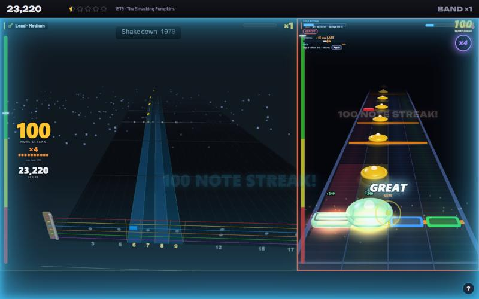

| | |
|---|---|
| 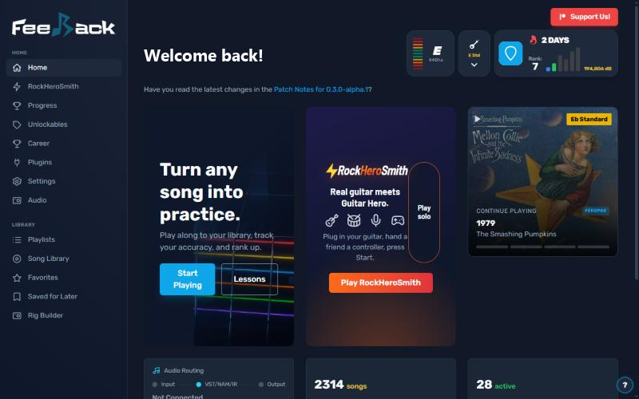 | 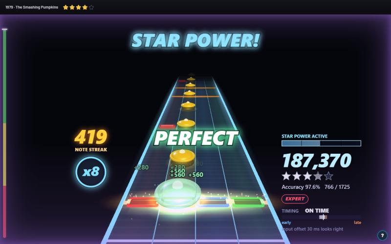 |
| Home: **Play RockHeroSmith** for a band, **Play solo** to play alone | Drums: star power doubles your multiplier (x8) |

## How to play RockHeroSmith

RockHeroSmith is the band mode: real guitar, a drum kit, a singer and Guitar Hero / Rock Band
controllers on one stage. You can play it **solo** (a band of one) or as a **band**.

### Solo: the quickest way in

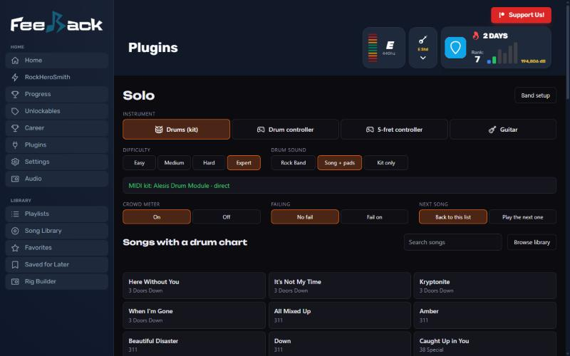

1. On Home, click **Play solo** (or RockHeroSmith → **Play solo**).
2. Pick your **instrument**: **Drums (kit)** for an electronic kit over MIDI, **Drum controller**,
   **5-fret controller** (a game pad or plastic guitar; Lead, Rhythm or Bass), or **Guitar** (real
   guitar or bass).
3. Pick the **difficulty** and, for drums, the **drum sound** (see [Drum sound](#drum-sound) below).
4. Click a song in the list (it only shows songs with that part). It starts right away.

The screen remembers everything, and Esc or **Next song** on the results brings you back to the list.

### Band: two or more players

| | |
|---|---|
| 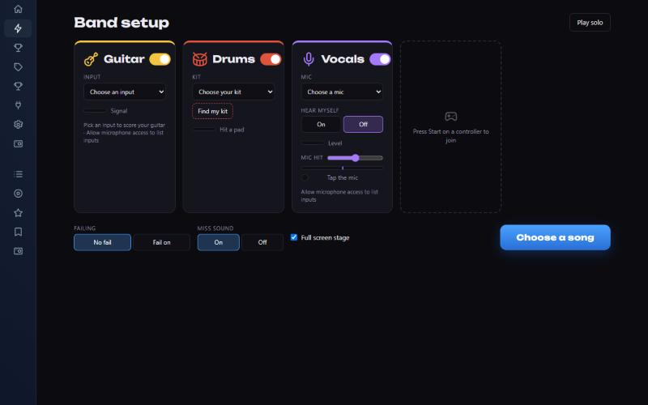 | 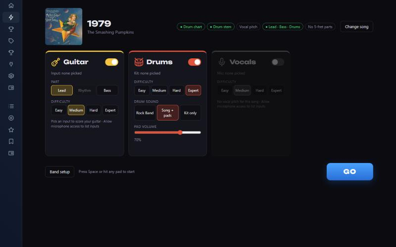 |
| 1. Band setup: turn parts on, pick inputs | 3. Confirm: part, difficulty and sound per player |

1. On Home, click **Play RockHeroSmith**. On **Band setup**, switch on the parts you have and
   pick their inputs: **Guitar** (your audio interface), **Drums** (your kit; **Find my kit**
   listens for a pad), **Vocals** (a mic). Game controllers join by pressing **Start**; an Xbox
   pad picks 5-Fret (**X**) or Drums (**B**).
2. **Choose a song**. The Song Library opens in pick mode with **Playable by band** on, so it only
   lists songs every player can play; filter by drum chart, 5-fret part, vocal pitch and so on.
3. On **Confirm**, set each player's part, difficulty and drum sound, then **GO** (or press Start
   on a controller, or hit any pad).

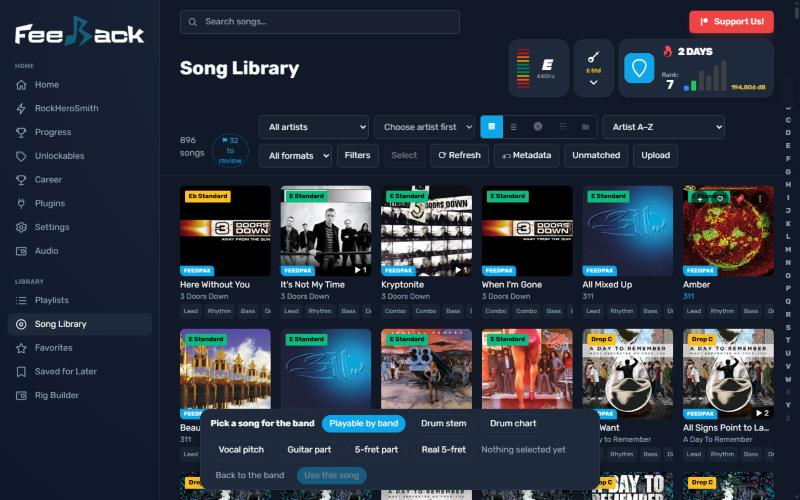

**In the song:** Start on a controller pauses; holding Back for a second asks to leave. **P**
opens each player's settings (difficulty, offsets, drum sound) without stopping the song, and
**M** opens the sidebar. After the song, the results show each player's sections; click one to
practise it on a loop.

### Tips

- **Drum sound:** **Rock Band** plays the song's drum track and drops it when
  you miss (your pads stay silent: you hear the record). **Song + pads** keeps the drum track and
  adds your pad sounds. **Kit only** mutes the drum track so you only hear your kit. Auto kick and
  auto cymbals always play their sound.
- **Timing:** set your **input offset** first, then a **kick offset** if your kick lands earlier or
  later than your hands. The end-of-song card measures both and offers an **Apply** button.
- **Hi-hat pedal:** Plugins → Drums → **Hi-hat pedal hits** chooses whether it's ignored (Rock
  Band), plays the chart's pedal notes, or works as a second kick.
- **Full screen stage** and **Miss sound** are switches on Band setup; **Failing** makes a band
  that drops too low fail the song.
- Feeling laggy? Turn off plugins you don't use on the Plugins page (it's a simple on/off list).

## What it adds over upstream feedBack

### Band play
- **RockHeroSmith** (new plugin): play a song together, real guitar alongside Guitar Hero-style
  controllers, a drum kit and a singer. Band HUD with score, stars and a crowd meter, overdrive per
  part, a Rock Band-style miss "clunk" and part audio that drops out when a player misses, and a
  results screen. First in the sidebar, with its own half of the Home screen and Press Start on a
  free controller.
- **5-Fret** (new plugin): Clone Hero-style guitar, rhythm and bass on a game controller or plastic
  guitar, on a YARG engine port: HOPOs, taps, sustains, star power with whammy, 3D highway.
- **Play as** menu on every song (and in the songs table): pick Play, a real-instrument arrangement,
  Drums, Vocals, a 5-fret part or RockHeroSmith, with a difficulty step where it applies.
- Library filters for Rock Band / Guitar Hero parts, a Parts facet, a Karaoke-ready filter, and
  part pills (5-fret G / R / B, drums D, vocals V) in the songs table.
- Drums, 5-fret and vocal plays count for stats, XP, progression, Career and Achievements (Flawless,
  On Fire, Expert, Pro Kit feats), with per-part bests and run history.

### Drums (Drum Highway 4.10)

| | |
|---|---|
| 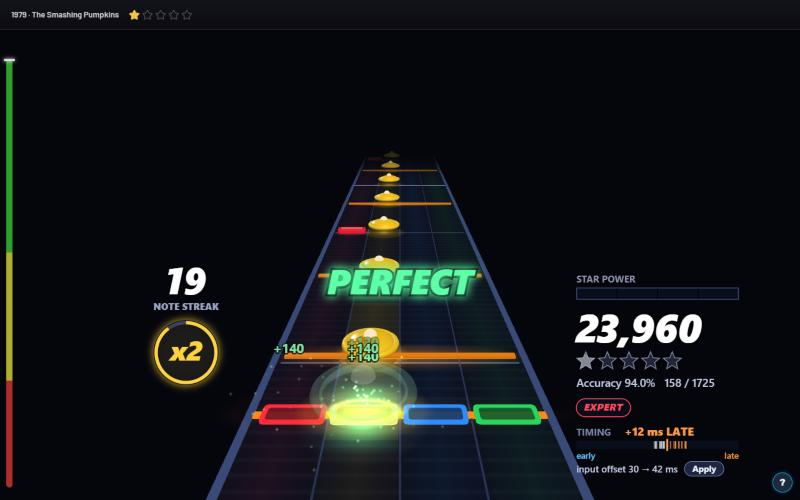 | 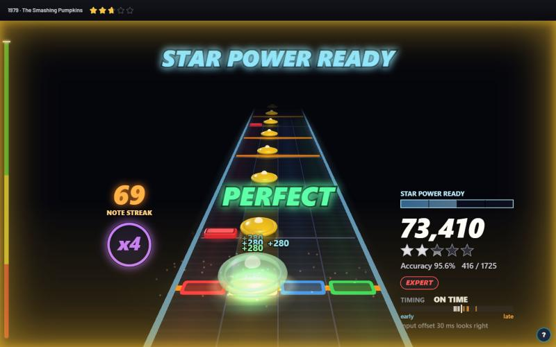 |
| Hit feedback: PERFECT, sparks, score pops | "STAR POWER READY", the streak burning orange at x4 |

- **Rock Band-style scoring** from a YARG drums engine port: multiplier, streak, stars, star power,
  drum fills that activate it, drum solos, accent / ghost bonuses.
- **Rock Band-style 3D drum track** (and a 2D lane view), keyboard drumming, drum controllers with a
  setup recorder and rebinding (Controllers card).
- **Star power on old drum packs**: packs made by the old drum joiner get their star power, fills and
  hand-charted Easy / Medium / Hard back without rewriting the packs.
- **Hit feedback**: hit notes pop and vanish, misses grey out with a red lane flash, overhits get a
  red ✕, sparks coloured by timing (green on time, blue early, orange late), PERFECT / GREAT / GOOD
  with EARLY / LATE and MISS over the strike line, a shake when a 10+ streak breaks.
- **Bigger HUD** with callouts: "x3 MULTIPLIER", "100 NOTE STREAK!", "STAR POWER READY",
  "STREAK LOST"; the streak burns orange then gold on a hot run. HUD size setting.
- **Freestyle fills** option (Rock Band): with star power ready a fill becomes a free zone ending on
  the glowing activation note.
- Difficulties Easy to Expert+, with missing lower levels generated from Expert; pro cymbals or
  4-lane; auto kick / auto cymbals per difficulty, which always play their drum sound.
- **Hi-hat pedal hits**: Ignore (Rock Band), Play pedal notes, or Second kick (left-foot double bass).
- Timing: hit-window presets, overhit rule (Penalize / Lenient / Ignore), input and kick offsets with
  an early/late meter that suggests them, MIDI arrival-time stamping, direct Windows MIDI (WinMM).
- Sounds: bundled multi-sampled kits (incl. the DRS and Crocell kits) and General MIDI kits, stereo
  room, velocity curves, hi-hat pedal (CC4) articulation, a MIDI monitor.
- Split view drums with per-panel difficulty, and public APIs / bus events for band mode.

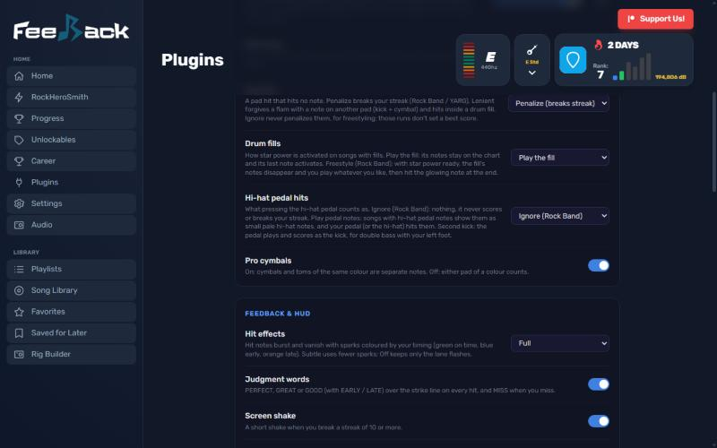

### Vocals (Lyrics Karaoke)
- Rock Band-style vocal scoring: phrases rated by pitch (octave-agnostic), score, multiplier, stars,
  difficulty levels.
- Vocal overdrive: earned on Strong+ phrases, deployed by a mic hit between phrases, doubles phrase
  points.
- Mic handling: only the mic you picked, an in-player mic picker, a warning about built-in mics or
  speakers, and hearing yourself through the game's output.
- Steadier pitch tracking, a batch tool that generates karaoke pitch for a library, Play as Vocals,
  and Rock Band / Clone Hero PART VOCALS import.

### Real guitar and bass
- **Scorecard** (new plugin): Rock Band-style score, streak, timing gauge, solo ratings and run
  history for real guitar.
- **Auto-Tuner** (new plugin): shifts the song live to your guitar's tuning; note detection and the
  highway follow.
- **Live Retune** (desktop): live pitch shift of the guitar you're playing, in semitones and cents.
- Note detection fixes: capo charts, fast chord runs no longer scored as early misses, scoring
  against the effective tuning, bend / slide flags, per-section stats; richer hit / miss events.
- NAM tone: a live preset picker in the player; presets keep their model and IR when edited.
- **Guitar Volume** (a master guitar fader) and **Tone Pack** (auto presets for Tone Automation).
- The app never opens a mic you didn't set up as the guitar input.

### Library and import
- Import Rock Band / Clone Hero / YARG drum charts, 5-fret guitar / rhythm / bass parts and vocals;
  play a Clone Hero songs folder straight from the library (converted on first play).
- `scripts/drums_library.py` (core): finds drum and 5-fret charts on Chorus Encore, aligns them to a
  song's audio and joins them into your packs; a 5-fret auto-charter (Onyx port) fills parts with no
  real chart.
- Drum difficulty (Rock Band 0–6 tiers) and generated-levels badges, a sortable Drums column.
- Songs table view, play queue from songs / albums / artists, native play counts with a Most played
  sort and full-combo badges, Rocksmith 2014 play counts (**Rocksmith Play Counts** plugin).
- **⟳ Refresh** on the Songs page picks up songs you've added to your DLC folder right away.
- Guitar Pro import fixes (hammer-ons, slides, ghost notes, fret-hand anchors) and guitar solo
  detection.

### Sync and playback
- Render clock phase-locked to the audio (no backward frames), count-in that follows the rewind and
  only plays when needed, A/V offset slider fixes.
- **Sync Lab** (measured A/V, guitar latency and drum input offsets), **Highway Tweaks** (stems
  clock, Rock Band-style hit / miss verdicts on the 3D highway), **Song Cents** (how far each
  recording sits off its chart tuning).
- Stems: no more under-run stutter; plugin mutes stack, fade and never get saved with the song.

### Multiplayer
- Join links and LAN access for players on other devices, guests kept in sync with clock stamps and
  output latency, the real arrangements and Drums in the part picker.

### App
- **Plugins page as a plain list** with search and on/off switches (the pedalboard is one click
  away); turned-off plugins don't load and their sidebar entries hide. Keep **3D Drum Highway** on:
  Auto picks the drum view through it.

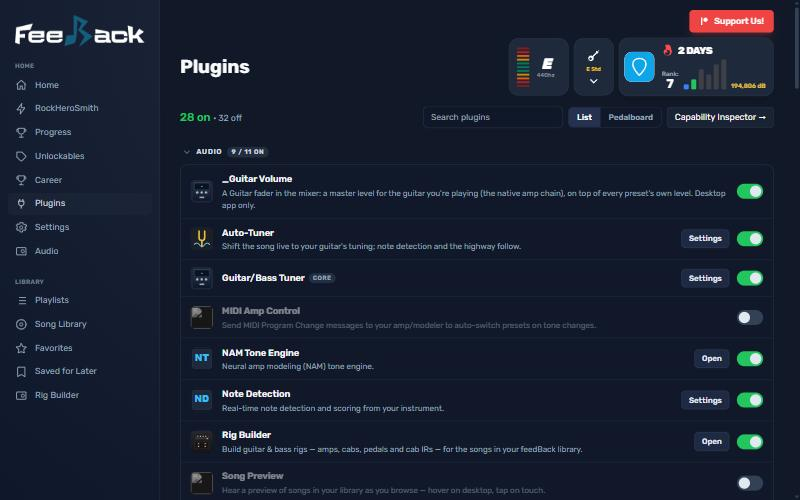
- **Miss sound** setting (Settings → Gameplay): Off, Clunk, or Clunk + dropout of your part.
- Visualization pickers list only the main highways; the input setup wizard keeps your instrument.
- Builds and updates come only from the `mattromano` forks; Mac builds run on `macos-15` and a
  failed platform no longer blocks the release.

## Where it lives

| Part | Repo | Branch |
|---|---|---|
| Desktop app (this repo) | [mattromano/feedBack-desktop](https://github.com/mattromano/feedBack-desktop) | `custom` |
| Core, plus Guitar Volume, Highway Tweaks, Rocksmith Play Counts, Song Cents, Sync Lab, Tone Pack | [mattromano/feedBack](https://github.com/mattromano/feedBack) | `custom` |
| Drum Highway | [mattromano/feedBack-plugin-drums](https://github.com/mattromano/feedBack-plugin-drums) | `custom` |
| Note Detection | [mattromano/feedBack-plugin-notedetect](https://github.com/mattromano/feedBack-plugin-notedetect) | `custom` |
| Stems | [mattromano/feedBack-plugin-stems](https://github.com/mattromano/feedBack-plugin-stems) | `custom` |
| Split Screen | [mattromano/feedBack-plugin-splitscreen](https://github.com/mattromano/feedBack-plugin-splitscreen) | `custom` |
| Multiplayer | [mattromano/feedBack-plugin-multiplayer](https://github.com/mattromano/feedBack-plugin-multiplayer) | `custom` |
| NAM Tone | [mattromano/feedBack-plugin-nam-tone](https://github.com/mattromano/feedBack-plugin-nam-tone) | `custom` |
| Lyrics Karaoke | [mattromano/feedBack-plugin-lyrics-karaoke](https://github.com/mattromano/feedBack-plugin-lyrics-karaoke) | `main` |
| RockHeroSmith, 5-Fret, Scorecard, Auto-Tuner (not in upstream) | `mattromano/feedBack-plugin-rockherosmith`, `-five-fret`, `-scorecard`, `-autotune` | `main` |
| Every other plugin | its `mattromano` fork, unchanged from upstream | default |

The full list is `scripts/build-common.sh` (`clone_slopsmith`). Upstream: [got-feedBack](https://github.com/got-feedBack).

## Credits

feedBack and its plugins are by the [got-feedBack](https://github.com/got-feedBack) contributors.
The drums and 5-fret engines are ports of [YARG.Core](https://github.com/YARC-Official/YARG.Core)
(LGPL-3.0); the 5-fret auto-charter ports parts of [Onyx](https://github.com/mtolly/onyx) (GPL-3.0).
See [THIRD_PARTY_LICENSES.md](THIRD_PARTY_LICENSES.md) and each plugin's NOTICE.
